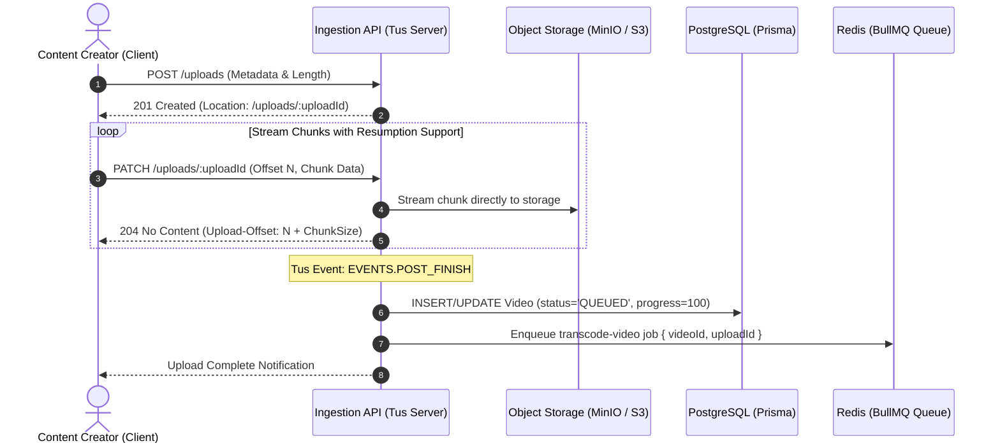
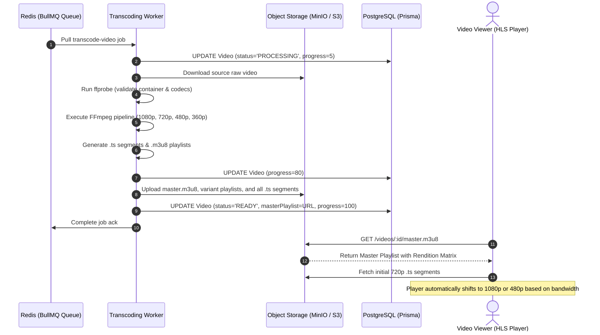

# Product Requirements Document (PRD)
## Scalable Video Streaming Platform (Enterprise / MNC-Grade)

**Document Version:** 1.0.0  
**Status:** Approved / In Development  
**Target Systems:** Microservices Architecture (API Server, Redis Queue, FFmpeg Worker Pool, MinIO/S3, PostgreSQL)  

---

## 1. Executive Summary & Objective

The objective of this project is to build an MNC-grade, highly resilient, scalable video streaming platform capable of handling massive raw video file uploads (multi-gigabyte 4K/1080p source files) over unstable client network connections, transcoding them asynchronously into multi-resolution Adaptive Bitrate Streams (ABR), and serving smooth, low-latency playback to a global viewer base across diverse devices and varying bandwidth constraints.

The platform eliminates the two most pervasive failure modes in modern media applications:
1. **Upload abandonment due to network interruptions:** Using standard HTTP POST for large uploads causes total upload failure whenever connections drop or fluctuate. We resolve this via protocol-level resumable chunked uploads (Tus protocol).
2. **Monolithic resource starvation during video rendering:** Transcoding video is CPU/GPU intensive. By decoupling ingestion from media processing via asynchronous distributed queues and containerized worker pools, the ingestion API remains responsive under peak traffic while video transcoding scales independently.

---

## 2. Target Audience & User Personas

### 2.1 Content Creators
- **Profile:** Independent video creators, media production studios, and enterprise contributors uploading high-definition video content (ranging from 100 MB to 50+ GB).
- **Network Reality:** Often uploading from home broadband, cellular tethering (4G/5G), coffee shop Wi-Fi, or developing markets with intermittent connectivity and packet loss.
- **Key Pain Points:**
  - Network drops midway through a 10 GB upload requiring a complete restart.
  - Browser freezes or tab closures losing hours of upload progress.
  - Lack of transparent, real-time feedback on processing and transcoding stages.

### 2.2 Viewers / Consumers
- **Profile:** End-users consuming video content across smartphones, tablets, smart TVs, and desktop browsers on networks ranging from congested 3G/4G cellular connections to high-speed fiber.
- **Key Pain Points:**
  - Buffering spinners, stuttering playback, and playback failure on weak cellular connections.
  - Long Time-To-First-Frame (TTFF) when initiating video playback.
  - Manual quality toggling required when network conditions degrade.

---

## 3. High-Level System Architecture

```
                  ┌────────────────────────────────────────┐
                  │          Client Application            │
                  │   (Next.js Web / Mobile Player)        │
                  └──────────────┬───────────────────▲─────┘
                                 │                   │
                      Tus Upload │                   │ HLS Video Playback
                     (Chunked)   │                   │ (ABR .m3u8 / .ts)
                                 ▼                   │
                  ┌──────────────────────┐   ┌───────┴──────────────┐
                  │   Ingestion API      │   │  CDN / Object Store  │
                  │  (Express + Tus)     │   │     (MinIO / S3)     │
                  └──────────┬───────────┘   └───────▲──────────────┘
                             │                       │
           1. DB Insert      │ 2. Push Job           │ 4. Upload HLS
          (Initial State)    │    (Transcode Task)   │    Segments & Playlist
                             ▼                       │
    ┌────────────────┐   ┌───────────────┐   ┌───────┴──────────────┐
    │   PostgreSQL   │   │  Redis Queue  │   │  FFmpeg Worker Pool  │
    │   (Prisma ORM) │   │   (BullMQ)    │──►│ (Horizontal Workers) │
    └────────────────┘   └───────────────┘   └──────────────────────┘
                             ▲                       │
                             │                       │
                             └───────────────────────┘
                               3. Pull Job & Heartbeat
```

### Core Architecture Layers:
1. **Ingestion Layer (API Server):** Express.js API integrating `@tus/server` protocol engine, handling resumable chunked transfers directly to object storage or persistent storage volumes.
2. **Queue & Broker Layer (Redis + BullMQ):** Decouples client HTTP request cycles from heavy media crunching. Provides job persistence, backpressure regulation, concurrency throttling, and automatic retry mechanisms.
3. **Processing Layer (FFmpeg Transcoding Workers):** Independent Node.js / Docker worker processes running FFmpeg to probe source media, transcode into target renditions (1080p, 720p, 480p, 360p), generate HLS `.ts` segments, and construct `.m3u8` master and variant playlists.
4. **Storage Layer (MinIO / S3):** Dual-tier object storage:
   - `raw-uploads`: Stores unprocessed source videos uploaded via Tus.
   - `transcoded-videos`: Public or pre-signed bucket housing segmented HLS assets (`master.m3u8`, quality playlists, `.ts` chunks).
5. **State Layer (PostgreSQL + Prisma ORM):** Tracks metadata, upload progress, transcode states (`UPLOADING`, `QUEUED`, `PROCESSING`, `READY`, `FAILED`), resolution availability, and playback paths.

---

## 4. Core Features & Functional Requirements

### 4.1 Protocol-Level Resumable Chunked Uploads (Tus Protocol)
- **Open Protocol Standard:** Implementation of the open-source **Tus 1.0.0 protocol** (`@tus/server`) to guarantee interoperability and survival across unstable network conditions.
- **Upload Creation & Offset Check:**
  - `POST /uploads`: Initializes upload metadata (filename, file size, mime-type) and generates a unique `uploadId`.
  - `HEAD /uploads/:uploadId`: Returns the current byte offset (`Upload-Offset`) to determine where resumption starts.
  - `PATCH /uploads/:uploadId`: Streams sequential binary chunks matching the current offset.
- **Client Auto-Resume:** The client upload library (e.g., `tus-js-client`) automatically retries on network drops with exponential backoff, querying the remote offset before streaming subsequent chunks.
- **Storage Target:** Chunks stream into S3-compatible object storage (MinIO/AWS S3) using multipart uploads, avoiding local server disk bottlenecks.
- **Completion Hook:** The server listens to `EVENTS.POST_FINISH` to mark upload completion, record video metadata in PostgreSQL, and trigger the transcoding pipeline.

### 4.2 Asynchronous Background Video Transcoding
- **Decoupled Job Dispatch:** On upload finalization, the API server dispatches a transcode job payload (`videoId`, `uploadId`, `sourcePath`) into a BullMQ queue backed by Redis.
- **Job Lifecycle & State Transitions:**
  - `UPLOADING`: File upload in progress.
  - `QUEUED`: File uploaded; job waiting in Redis queue.
  - `PROCESSING`: Transcoding worker actively executing FFmpeg pipelines. Real-time percentage progress (0–100%) tracked in the database.
  - `READY`: Transcoding succeeded, HLS playlists validated, and assets published.
  - `FAILED`: Unrecoverable encoding error, with detailed failure diagnostics recorded for developer inspection.
- **Video Probing:** Workers execute `ffprobe` on the source file to extract resolution, aspect ratio, audio channels, duration, container format, and codec parameters before launching transcode tasks.
- **Atomic Asset Delivery:** Transcoding workers output segment files and playlists into a local sandbox or temporary directory, upload all segments and playlists to object storage, and update the database transactionally.

### 4.3 Adaptive Bitrate Streaming (ABR)
- **HLS (HTTP Live Streaming) Standard:** Master playlist (`master.m3u8`) with child playlists (`index.m3u8`) for discrete video renditions.
- **Rendition Matrix (H.264 / AAC):**
  | Resolution | Name | Target Bitrate | Max Bitrate | Buffer Size | Audio Bitrate | Target Frame Rate |
  | :--- | :--- | :--- | :--- | :--- | :--- | :--- |
  | **1920x1080** | 1080p | 4500 kbps | 5000 kbps | 9000 k | 192 kbps | 30 / 60 fps |
  | **1280x720** | 720p | 2500 kbps | 2800 kbps | 5000 k | 128 kbps | 30 fps |
  | **854x480** | 480p | 1200 kbps | 1400 kbps | 2400 k | 96 kbps | 30 fps |
  | **640x360** | 360p | 600 kbps | 700 kbps | 1200 k | 64 kbps | 30 fps |

- **Segment Configuration:** Segment length set to **4 seconds** to provide an optimal balance between low startup latency (quick initial segment fetch) and CDN HTTP request overhead.
- **Intelligent Upscaling Guard:** Workers do not transcode resolutions higher than the source file (e.g., a 720p upload will only produce 720p, 480p, and 360p renditions).
- **Dynamic Bitrate Switching:** Video players (Hls.js / Video.js) continuously measure network throughput and buffer occupancy, seamlessly switching between rendition streams without playback interruption or audio drift.

---

## 5. Edge Cases & Resilience Engineering

| Edge Case | Failure Scenario | Automated Platform Mitigation |
| :--- | :--- | :--- |
| **Mid-Upload Network Failures** | Creator's connection drops, switches from Wi-Fi to 4G, or experiences intermittent packet timeouts during a multi-gigabyte upload. | 1. Client pauses transmission and initiates retry with exponential backoff (1s, 2s, 4s, up to 30s).<br>2. Client sends `HEAD` request to read the latest `Upload-Offset` recorded by the server.<br>3. Transmission resumes precisely from byte offset `N` without re-uploading previously accepted chunks. |
| **Corrupted Video Chunks & Malformed Payloads** | Network corruption alters chunk bytes, or a non-video payload (corrupted container, truncated bitstream) is uploaded. | 1. Tus checksum extension verifies MD5/SHA-256 chunk hashes upon receipt.<br>2. Before launching full transcoding, workers execute an explicit `ffprobe` sanity check.<br>3. If corrupted or unreadable, the job fails immediately, status updates to `FAILED`, the corrupted source file is quarantined, and the client receives a clear descriptive error. |
| **Worker Node Crashes During FFmpeg Processing** | Worker server runs out of memory (OOM), suffers host termination, or crashes mid-transcode while processing a massive file. | 1. BullMQ detects worker absence via heartbeat stall timer (`lockDuration`, `stalledInterval`).<br>2. Incomplete local temporary files are cleared.<br>3. BullMQ automatically re-queues the job to an available healthy worker (up to max retry threshold, e.g., 3 attempts).<br>4. Job failure is isolated; the API server remains completely unaffected. |
| **Simultaneous Massive File Uploads** | Spike in traffic where hundreds of creators upload 10 GB+ files concurrently, threatening disk saturation and connection exhaustion. | 1. Zero local disk dependency: chunks stream directly to S3/MinIO storage.<br>2. Reverse proxy / Ingestion API enforces request body throttling and rate limiting per IP / User.<br>3. Tus concurrency locks prevent simultaneous conflicting writes to the same upload ID.<br>4. Object storage lifecycle rules automatically clean up abandoned partial uploads older than 48 hours. |
| **Storage Quota / Write Failure** | Object storage experiences partial degradation or reaches write limit during segment uploads. | 1. S3 SDK operations implement exponential backoff retry for segment uploads.<br>2. Worker holds completed renditions in local scratch cache until all segments and playlists verify successfully in storage.<br>3. If storage write fails permanently, job alerts monitoring and logs structured telemetry. |

---

## 6. Non-Functional Requirements (NFRs)

### 6.1 High Availability & Fault Tolerance
- **SLA Target:** 99.9% uptime for video playback; 99.5% for upload ingestion.
- **Stateless Services:** Both the Express Ingestion API and FFmpeg worker processes must remain 100% stateless. Any session or upload tracking resides exclusively in Redis and PostgreSQL.
- **Failure Domain Isolation:** A catastrophic failure in the transcoding worker cluster must have zero impact on video ingestion or ongoing playback of previously processed videos.

### 6.2 Decoupling of API and Processing Layers
- **Asynchronous Handoff:** Ingestion endpoints must never execute heavy computational tasks (like transcoding, resizing, or audio extraction) synchronously within the HTTP request lifecycle.
- **Independent Failure Modes:** The API server solely validates inputs, negotiates Tus offsets, writes initial database records, and enqueues tasks. The worker pool reads jobs from Redis independently.

### 6.3 Horizontal Scalability
- **Worker Auto-Scaling:** Worker nodes must scale horizontally based on Redis queue depth (`waiting` jobs) and average CPU/GPU load.
- **Containerization:** Transcoding workers packaged as lightweight Docker containers configured with FFmpeg binaries, capable of scaling across Kubernetes (HPA) or cloud container instances (ECS/EKS).
- **Concurrency Throttling:** Each worker node limits concurrent FFmpeg processes based on available CPU cores (e.g., 1–2 jobs per 4-core instance) to prevent CPU starvation and OOM crashes.

### 6.4 Low-Latency Playback & Fast Start
- **Time to First Frame (TTFF):** Playback must begin in under **800ms** on broadband connections and under **1.5s** on standard mobile connections.
- **Short Initial Chunk Fetch:** The 4-second HLS segment duration allows the video player to load the first segment swiftly and begin playback while buffering subsequent segments.
- **CDN Edge Caching:** Static `.m3u8` playlists configured with short TTL cache headers (e.g., 2–5 seconds during live/processing; permanent once `READY`), and `.ts` media segments cached permanently (`Cache-Control: public, max-age=31536000, immutable`).

### 6.5 Security & Data Governance
- **Pre-signed URLs / Authenticated Uploads:** Ingestion requests must validate creator authentication before issuing upload endpoints.
- **CORS Hardening:** Strict CORS policies ensuring video uploads and playback can only be consumed from authorized application domains.
- **Payload Validation:** Source file magic numbers validated via `ffprobe` to prevent arbitrary file upload vulnerabilities masquerading as video containers.

---

## 7. Data Models & Entity Schemas

### 7.1 PostgreSQL Data Model (Prisma Schema Reference)

```prisma
enum VideoStatus {
  UPLOADING
  QUEUED
  PROCESSING
  READY
  FAILED
}

model Video {
  id              String         @id @default(uuid())
  title           String?        @default("Untitled Video")
  originalName    String?
  uploadId        String         @unique
  fileSize        BigInt?
  duration        Float?         // Duration in seconds
  mimeType        String?
  status          VideoStatus    @default(UPLOADING)
  progress        Int            @default(0) // Percentage 0 - 100
  masterPlaylist  String?        // Storage key/URL to master.m3u8
  resolutions     String[]       @default([]) // e.g. ["1080p", "720p", "480p", "360p"]
  errorMessage    String?
  createdAt       DateTime       @default(now())
  updatedAt       DateTime       @updatedAt

  renditions      Rendition[]

  @@index([status])
  @@index([uploadId])
}

model Rendition {
  id              String         @id @default(uuid())
  videoId         String
  resolution      String         // e.g. "1080p"
  bitrate         Int            // In bps
  playlistPath    String         // Path to rendition index.m3u8
  segmentCount    Int            @default(0)
  createdAt       DateTime       @default(now())

  video           Video          @relation(fields: [videoId], references: [id], onDelete: Cascade)

  @@index([videoId])
}
```

---

## 8. API & Protocol Specifications

### 8.1 Ingestion Endpoints (Tus 1.0.0 Protocol)
- `POST /uploads`
  - **Headers:** `Upload-Length`, `Upload-Metadata` (Base64-encoded filename, mimeType, creatorId)
  - **Response:** `201 Created` with `Location: /uploads/{uploadId}`
- `HEAD /uploads/:uploadId`
  - **Response:** `200 OK` with `Upload-Offset: {currentBytes}`, `Upload-Length: {totalBytes}`
- `PATCH /uploads/:uploadId`
  - **Headers:** `Upload-Offset: {currentBytes}`, `Content-Type: application/offset+octet-stream`
  - **Body:** Binary video chunk
  - **Response:** `204 No Content` with `Upload-Offset: {newBytes}`
- `DELETE /uploads/:uploadId`
  - **Response:** `204 No Content` (Terminates and purges aborted upload)

### 8.2 Application REST Endpoints
- `GET /videos`
  - Returns paginated list of videos and their processing statuses.
- `GET /videos/:id`
  - Returns video metadata, processing progress, and `masterPlaylist` streaming URL.
- `GET /videos/:id/status`
  - Lightweight endpoint for client polling to track real-time transcoding progress.

---

## 9. Sequence Workflows

### 9.1 Resumable Chunked Upload Sequence


### 9.2 Asynchronous Transcoding & ABR Delivery Sequence


---

## 10. Operational Metrics & Key Performance Indicators (KPIs)

1. **Upload Reliability Rate:** `>= 99.8%` of initiated uploads must complete successfully, even over simulated packet loss conditions of up to 15%.
2. **Transcoding Success Rate:** `>= 99.5%` for standard valid video containers (MP4, MOV, MKV, AVI, WebM).
3. **Transcoding Speed Ratio:** Transcoding duration must not exceed **1.2x of total video length** on standard worker hardware (e.g., a 10-minute 1080p video transcodes in under 12 minutes).
4. **Playback Buffer Rate:** Less than `0.5%` of total playback time spent buffering across all sessions.
5. **Worker Recovery MTTR:** Maximum Time-To-Recovery (MTTR) under worker pod termination `< 15 seconds` for job re-assignment.

---

## 11. Implementation Roadmap & Milestones

- **Phase 1: Ingestion Foundation (Current)**
  - Express.js API with `@tus/server` and `@tus/file-store` / S3 store.
  - PostgreSQL schema and Prisma ORM integration.
  - `POST_FINISH` lifecycle hook registering video records.
- **Phase 2: Queue & Distributed Storage Integration**
  - Replace local file store with MinIO / S3 bucket storage.
  - BullMQ queue initialization with Redis connection pooling.
  - Dispatching transcode events on upload finalization.
- **Phase 3: FFmpeg Transcoding Worker Cluster**
  - Implement worker consumer daemon using `bullmq` and `fluent-ffmpeg`.
  - Multi-rendition ABR packaging script (1080p, 720p, 480p, 360p).
  - Automated generation of HLS playlists and S3 asset upload.
- **Phase 4: Client Playback & Monitoring**
  - Frontend Next.js integration with `tus-js-client` upload manager.
  - Adaptive streaming player integration (`video.js` / `hls.js`).
  - Worker health metrics, queue telemetry, and Prometheus/Grafana dashboards.
